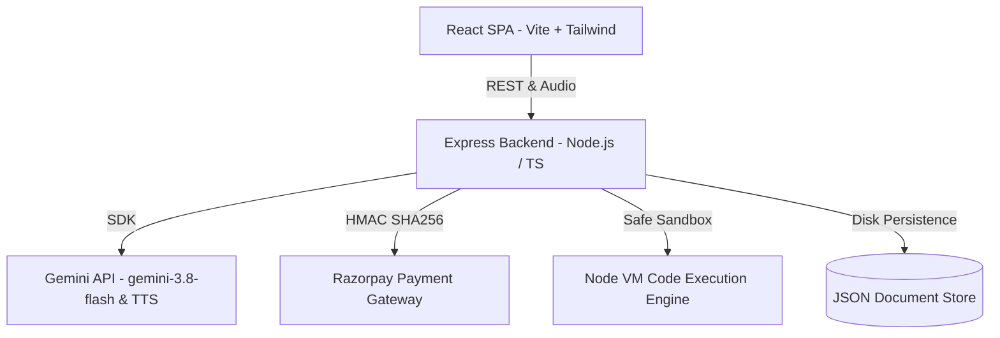

# System Architecture — Tanya AI Interviewer

## 1. System Overview

Tanya AI Interviewer is an enterprise-grade AI mock interview SaaS platform engineered with a strict full-stack separation of concerns.

## 2. Key Modules

### Frontend (`src/`)
- **State & Context**: `AuthContext.tsx` handles JWT/session persistence and instant demo accounts switching.
- **Tanya Avatar Component**: Renders realistic visual states (`speaking`, `listening`, `thinking`), audio waveform visualizer bars, and multi-voice audio synthesis.
- **Speech Controller**: Web Speech Recognition with live streaming transcript and resilient text fallback.
- **Monaco Coding Sandbox**: Multi-language code editor with test cases runner, stdout terminal, and Big-O complexity analyzer.
- **Evaluation Scorecard**: Comprehensive radar and breakdown modal assessing Technical Accuracy, Communication Clarity, Problem Solving, and Culture Fit.

### Backend (`server/`)
- **Server Entrypoint (`server.ts`)**: Express server with Vite middlewares mounted in development, serving optimized static assets in production.
- **Gemini Service (`server/services/geminiService.ts`)**: Server-side LLM orchestrator using `@google/genai` (User-Agent `aistudio-build`, `gemini-3.8-flash` for evaluation, `gemini-3.8-flash-lite-tts` for WAV voice generation).
- **Razorpay Service (`server/services/razorpayService.ts`)**: Test-mode order creation, HMAC-SHA256 signature verification, webhook handling, and subscription state machines.
- **Code Execution Sandbox (`server/services/codeExecutionService.ts`)**: Sandboxed runner executing test cases against user code in JavaScript, TypeScript, Python, C++, and Java with timeout limits.
- **Resume Parser Service (`server/services/resumeParserService.ts`)**: Resume ATS score calculator and tailored question generator.
- **Database Store (`server/db/store.ts`)**: In-memory + disk-persisted document store for users, resumes, interview sessions, reports, payments, and audit logs.
