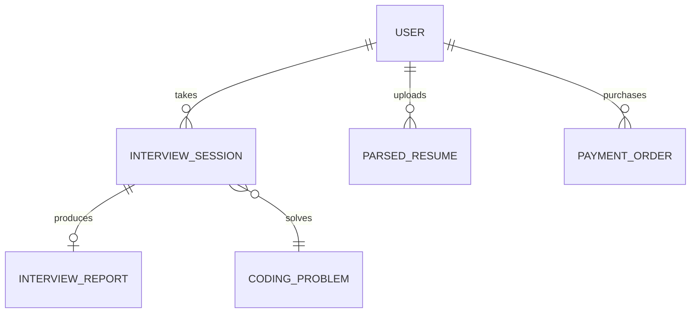

# Database Schema & Data Models

Tanya AI Interviewer utilizes an encapsulated document store pattern backed by JSON disk serialization in `data/tanya_database.json`, with schemas defined in `server/db/schema.ts`.

## Entity Relationship Diagram

## Collections & Schemas

### 1. `User`
- `id` (string, PK)
- `email` (string, unique)
- `name` (string)
- `role` ('candidate' | 'admin')
- `subscriptionTier` ('free' | 'premium')
- `interviewCreditsRemaining` (number)
- `avatarUrl` (string)
- `createdAt` (ISO timestamp)
- `passwordHash` (string)

### 2. `InterviewSession`
- `id` (string, PK)
- `userId` (string, FK to User)
- `type` ('hr' | 'technical' | 'resume' | 'dsa')
- `roleTarget` (string)
- `difficulty` ('entry' | 'mid' | 'senior' | 'staff')
- `status` ('in_progress' | 'completed' | 'abandoned')
- `startedAt` / `completedAt` (ISO timestamp)
- `messages` (Array of sender, text, codeSnippet, language, timestamp)
- `currentQuestionIndex` / `totalQuestions` (number)
- `questions` (Array of question metadata & expected points)

### 3. `InterviewReport`
- `id` (string, PK)
- `sessionId` (string, FK to InterviewSession)
- `overallScore` (number 0-100)
- `recommendation` ('Strong Hire' | 'Hire' | 'Lean Hire' | 'No Hire')
- `categoryScores` (technicalAccuracy, communicationClarity, problemSolving, culturalAlignment)
- `keyStrengths` / `growthAreas` (string arrays)
- `questionEvaluations` (Array of detailed evaluations)

### 4. `ParsedResume`
- `id` (string, PK)
- `userId` (string, FK to User)
- `fileName` (string)
- `atsScore` (number 0-100)
- `extractedSkills` (string array)
- `tailoredQuestions` (string array)

### 5. `PaymentOrder`
- `id` (string, PK)
- `orderId` (string, unique Razorpay Order ID)
- `userId` (string, FK to User)
- `amount` (number in paise)
- `currency` (string, e.g. "INR")
- `status` ('created' | 'paid' | 'failed')
- `razorpayPaymentId` (string)
- `razorpaySignature` (string)
